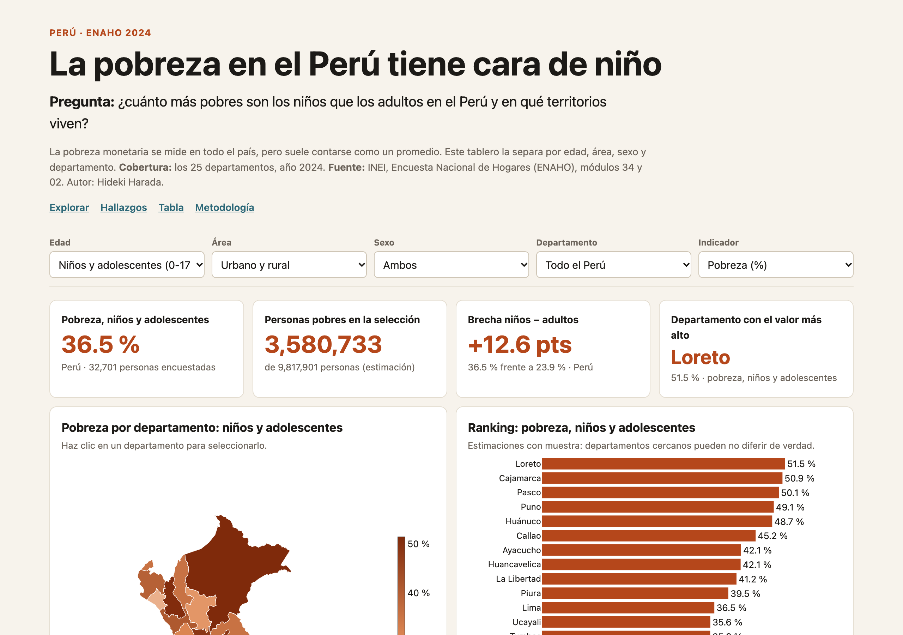
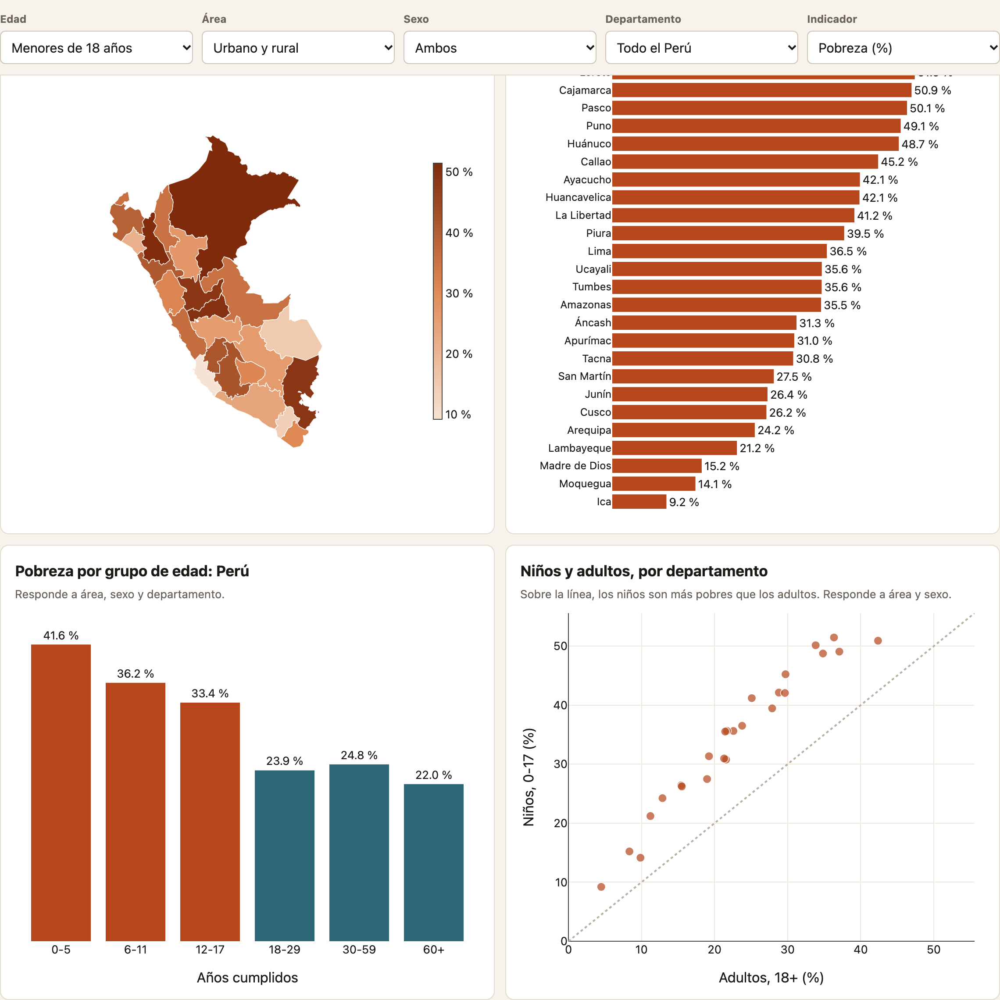

# La pobreza en el Perú tiene cara de niño

**Tarea 3, Python Intermedio.** Autor: Hideki Harada.

- **Dashboard:** https://haradaoyakawahideki.github.io/pobreza-infantil-peru/web/
- **Reel** (sin cuenta de LinkedIn, se usa la alternativa de la tarea): [reel/reel.mp4](reel/reel.mp4)

## Tema y pregunta

Pobreza monetaria por edad en el Perú, 2024. **¿Cómo se distribuye la pobreza por grupo etario en el Perú?**

## Descripción

Un dashboard interactivo y un reel muestran la pobreza por edad, área, sexo y departamento en los 25 departamentos.




## Fuentes y metodología

- [INEI, microdatos ENAHO 2024](https://proyectos.inei.gob.pe/microdatos/), código 966: módulos 34 (sumaria) y 02 (miembros).
- [Límites departamentales del curso](https://github.com/d2cml-ai/Data-Science-Python/tree/main/sessions/06-geoespacial/lab/Data).

Se conservan 108,664 residentes habituales y se pondera con `facpob07`. Es pobre quien vive en un hogar con gasto per cápita bajo la línea de pobreza. El proceso se detiene si no replica las cifras oficiales: 27.6 % de pobreza y 5.5 % de pobreza extrema. Los intervalos de confianza al 95 % usan linealización por conglomerados, con departamento × área como aproximación a los estratos de diseño; están en `datos/procesados/`.

## Tres hallazgos

| Hallazgo | Cifra (IC 95 %) |
|---|---|
| Los menores de 18 son más pobres que los adultos. Son 28.8 % de la población y 38.1 % de las personas pobres. | 36.5 % (35.2-37.8) frente a 23.9 % (23.0-24.9) |
| Los menores de 6 años tienen la tasa más alta, y la tasa de niños supera a la de adultos en los 25 departamentos. | 41.6 % (39.8-43.4) |
| El riesgo es mayor en zonas rurales, pero la mayoría de niños pobres vive en zonas urbanas: 71.4 %. | Rural 48.1 % (46.1-50.1), urbano 33.2 % (31.7-34.8) |

## Limitaciones

- Un solo año: no muestra tendencias ni causas.
- La medida es por hogar y supone un reparto igual del gasto entre sus miembros, sin distinguir necesidades por edad.
- Los márgenes departamentales son amplios (Loreto: 46.8-56.1 %), así que el orden exacto del ranking no es firme.
- Con filtros finos la muestra cae: el dashboard avisa bajo 100 casos y oculta valores bajo 30.

## Cómo reproducir

```bash
pip install -r requirements.txt
python scripts/obtener_datos.py
python scripts/procesar_datos.py
python scripts/analizar_datos.py
python -m http.server 8765   # abre http://localhost:8765/web/
```

Para el reel: `pip install qwen-tts faster-whisper pillow imageio-ffmpeg soundfile jiwer num2words librosa`, luego `python reel/preparar_recursos.py` y `python reel/generar_voz.py <tu_voz.m4a> cpu` y `python reel/hacer_reel.py` (el texto de referencia está en `generar_voz.py`). `reel/motor_sesion15.py` es el código de la [Sesión 15 del curso](https://github.com/d2cml-ai/Data-Science-Python/tree/main/sessions/15-texto-a-reel). La grabación de voz no se publica.

## Uso de inteligencia artificial

Claude Code ayudó con el código, el dashboard, el guion y el video. La narración se generó con Qwen3-TTS a partir de la voz del autor. La música es una pista sintetizada por código para este proyecto. Las cifras provienen de los microdatos del INEI procesados en este repositorio.
